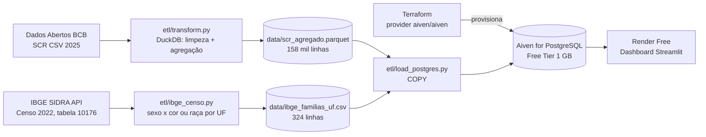

# Acesso a Microcrédito e Inclusão Financeira Regional

Projeto prático de Computação em Nuvem — **Grupo 5** (Pedro Gustavo, Rodrigo de Carvalho, Gabriel Oliveira, Victor Costa, Giovana Amaral).
Pipeline de dados em nuvem a custo zero com **Aiven (free tier)**, voltado às ODS 5 e 18 (inclusão financeira regional e por perfil).

**Fontes públicas oficiais:**
- SCR – Sistema de Informações de Crédito, Banco Central do Brasil (dados abertos), 12 meses de 2025 (~1,2 GB de CSV, 3,8 mi de linhas).
- IBGE – Censo Demográfico 2022, [tabela 10176](https://sidra.ibge.gov.br/tabela/10176) (SIDRA): famílias por **sexo e cor ou raça da pessoa responsável**, por UF.

> ⚠️ **Limitação importante:** a base pública do SCR **não possui sexo nem raça/cor** do tomador. Por isso o recorte de **gênero × raça (ODS 5 e 18)** vem do IBGE e é cruzado com o crédito **por UF** (análise ecológica: mostra onde há mais famílias chefiadas por mulheres negras, não quem recebeu cada empréstimo). Dentro do SCR, o recorte demográfico usa **tipo de cliente (PF/PJ), porte da empresa, faixa de renda e região/UF**. O "perfil microcrédito" é uma *aproximação* (PJ micro/pequena ou PF com renda até 2 salários mínimos/sem rendimento). Isso deve ser dito na apresentação.

## Arquitetura



## Estrutura

| Pasta | Conteúdo |
|---|---|
| `terraform/` | `main.tf`, `variables.tf`, `outputs.tf` — cria o PostgreSQL gratuito na Aiven (sem token no código) |
| `etl/` | `transform.py` (limpeza/agregação do SCR), `ibge_censo.py` (download do IBGE) e `load_postgres.py` (carga) |
| `sql/` | `schema.sql` (modelagem + índices), `grants.sql` (usuário somente leitura) |
| `dashboard/` | `app.py` (Streamlit, 8 gráficos + 7 KPIs + filtros) |
| `data/` | `scr_agregado.parquet` (resultado do ETL, 3,9 MB) e `ibge_familias_uf.csv` (IBGE, 324 linhas) |

## Manual de execução (passo a passo)

**Pré-requisitos:** Python 3.10+, [Terraform](https://developer.hashicorp.com/terraform/install), conta gratuita na [Aiven](https://console.aiven.io).

1. **Instalar dependências**
   ```
   pip install -r requirements.txt
   ```
2. **(Opcional se já existir `data/scr_agregado.parquet`) Rodar o ETL** apontando para a pasta com os CSVs `scrdata_2025MM.csv`:
   ```
   python etl/transform.py --input CAMINHO_DOS_CSVS --output data/scr_agregado.parquet
   ```
   E, para o recorte de gênero × raça (opcional se já existir `data/ibge_familias_uf.csv`), baixar os dados do IBGE:
   ```
   python etl/ibge_censo.py --output data/ibge_familias_uf.csv
   ```
3. **Criar o banco na Aiven com Terraform** — gere um token em *Console Aiven → User information → Tokens* e anote o nome do projeto:
   ```powershell
   cd terraform
   $env:TF_VAR_aiven_api_token = "SEU_TOKEN"
   copy terraform.tfvars.example terraform.tfvars   # edite aiven_project_name
   terraform init
   terraform apply
   cd ..
   ```
   > O plano gratuito só existe em algumas regiões. Se o `apply` reclamar de plano/cloud, ajuste `pg_plan` / `cloud_name` em `terraform/variables.tf` conforme a console.
4. **Carregar os dados**
   ```powershell
   $env:DATABASE_URL = (terraform -chdir=terraform output -raw pg_service_uri)
   python etl/load_postgres.py
   ```
   Carrega as tabelas `fato_credito` (SCR) e `ibge_familias_uf` (IBGE). A carga usa o banco da URI do serviço (`defaultdb`).
5. **Rodar o dashboard**
   ```powershell
   streamlit run dashboard/app.py
   ```
   Com `DATABASE_URL` definida ele lê da Aiven; sem ela, **ou se o banco não responder**, usa os arquivos locais da pasta `data/` (modo demonstração) e avisa no topo da página.
6. **Publicar no Render (plano Free):** *New +* → *Web Service* → *Public Git Repository* com a URL deste repositório. Configure:
   - Build: `pip install -r requirements.txt`
   - Start: `streamlit run dashboard/app.py --server.port $PORT --server.address 0.0.0.0 --server.headless true`
   - Instance type: **Free**; variáveis `PYTHON_VERSION=3.12.7` e `DATABASE_URL` (Service URI da Aiven, só no painel do Render).
   (O arquivo `render.yaml` traz a mesma configuração para quem preferir *Blueprint*.)

   **Dashboard online:** https://dashboard-microcredito.onrender.com

   > No plano Free o Render "dorme" após ~15 min sem acesso e leva cerca de 1 min para acordar. Abra o link antes da apresentação. O banco free da Aiven também desliga por inatividade.

## Tratamento de dados (ETL)

- Tipagem: `data_base` → `DATE`; valores com vírgula decimal → `DOUBLE`/`NUMERIC`.
- Nulos: `numero_de_operacoes = -1` (sigilo do BCB) → `NULL`; porte "Indisponível" → "Não informado".
- Enriquecimento: UF → região; flag `perfil_microcredito`.
- Agregação por mês × UF × segmento × cliente × porte × modalidade × origem (descarta CNAE/submodalidade/indexador) para caber nos 1 GB do plano grátis. Resultado: 3,8 mi → 158 mil linhas.
- IBGE: código da UF → sigla (chave de cruzamento com o SCR); valores "-" / "..." do SIDRA → 0; mantidos só os totais de número de componentes e de nível de instrução.

## Dicionário de variáveis (tabela `fato_credito`)

| Coluna | Descrição |
|---|---|
| `data_base` | Último dia do mês de referência |
| `uf`, `regiao` | Estado e região do Brasil |
| `segmento` | Tipo de instituição (Banco, Cooperativa, Financeira, Fintech…) |
| `cliente` | `PF` (pessoa física) ou `PJ` |
| `porte` | PJ: Micro/Pequeno/Médio/Grande; PF: faixa de renda em salários mínimos |
| `modalidade` | Empréstimos, Financiamentos, Financiamentos rurais, etc. |
| `origem` | Com/sem destinação específica (ex.: crédito direcionado) |
| `perfil_microcredito` | Proxy descrita acima |
| `n_registros` | Nº de linhas originais agregadas |
| `numero_operacoes` | Soma de operações (NULL se sigiloso) |
| `carteira_ativa` | Saldo total da carteira (R$) |
| `carteira_inadimplencia` | Saldo vencido há mais de 90 dias (R$) |
| `ativo_problematico` | Saldo classificado como ativo problemático (R$) |
| `carteira_vencida` | Saldo vencido (R$) |

## Dicionário de variáveis (tabela `ibge_familias_uf`)

| Coluna | Descrição |
|---|---|
| `uf` | Sigla do estado (chave de cruzamento com `fato_credito`) |
| `sexo` | Sexo da pessoa responsável pela família: `Homens` ou `Mulheres` |
| `cor_raca` | Cor ou raça da pessoa responsável: Branca, Preta, Parda, Amarela, Indígena, Sem declaração |
| `familias` | Nº de famílias (únicas e conviventes principais) em domicílios particulares permanentes, Censo 2022 |

## Métricas do dashboard

KPIs: carteira ativa, % em perfil microcrédito, inadimplência geral e do perfil microcrédito; % de famílias chefiadas por mulheres, por pessoas negras e por mulheres negras. Gráficos: distribuição regional, inadimplência região × perfil, participação por UF, evolução mensal, porte/renda, segmento da instituição e, na seção 7 (ODS 5 e 18), quem chefia as famílias em cada UF (sexo × cor ou raça) e o cruzamento "% de famílias chefiadas por mulheres negras × % da carteira em perfil microcrédito", com a correlação entre as duas. Filtros: período, região, UF, PF/PJ, segmento, somente microcrédito.

## Roteiro da apresentação (10 min)

1. **Antes de começar:** na console da Aiven, confira se o `pg-microcredito` está *Running* (o banco gratuito desliga por inatividade; se estiver desligado, clique em *Power on*). Abra o dashboard 2 minutos antes para o Render "acordar".
2. **Terraform rodando:** mostre `main.tf` / `variables.tf` e rode `terraform init` e `terraform plan` na pasta `terraform/`, com o `terraform.tfstate` de quem criou o banco. Sem esse arquivo, o `plan` vai propor criar o banco de novo: nesse caso importe o que já existe com `terraform import aiven_pg.microcredito NOME_DO_PROJETO/pg-microcredito` antes do `plan`. Não rode `apply` ao vivo.
3. **Dados na Aiven:** mostre o serviço *Running* na console e as tabelas `fato_credito` e `ibge_familias_uf`.
4. **Dashboard em tempo real:** troque filtros (região, UF, PF/PJ, só microcrédito) e termine na seção 7 (gênero × raça).
5. **Limitações:** explique que o SCR não traz sexo/raça e que o cruzamento com o IBGE é por UF.

## Segurança

Nenhum token ou senha no repositório: token via `TF_VAR_aiven_api_token`, conexão via `DATABASE_URL`/secrets (`.gitignore` cobre `.env`, `*.tfstate`, `terraform.tfvars`, `secrets.toml`).
